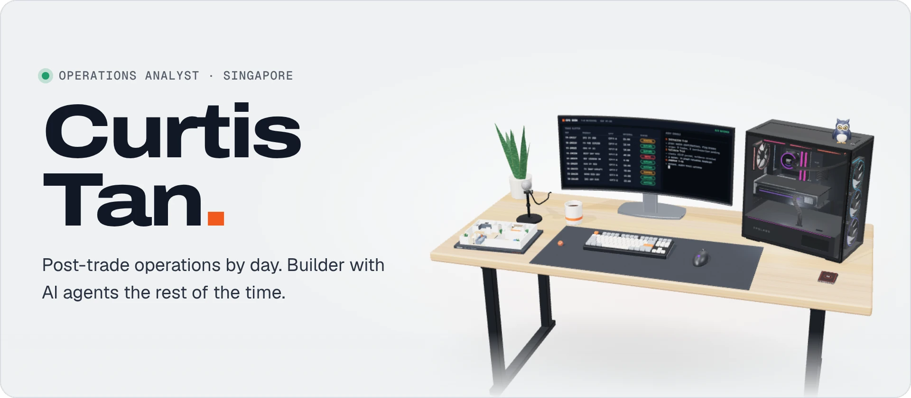
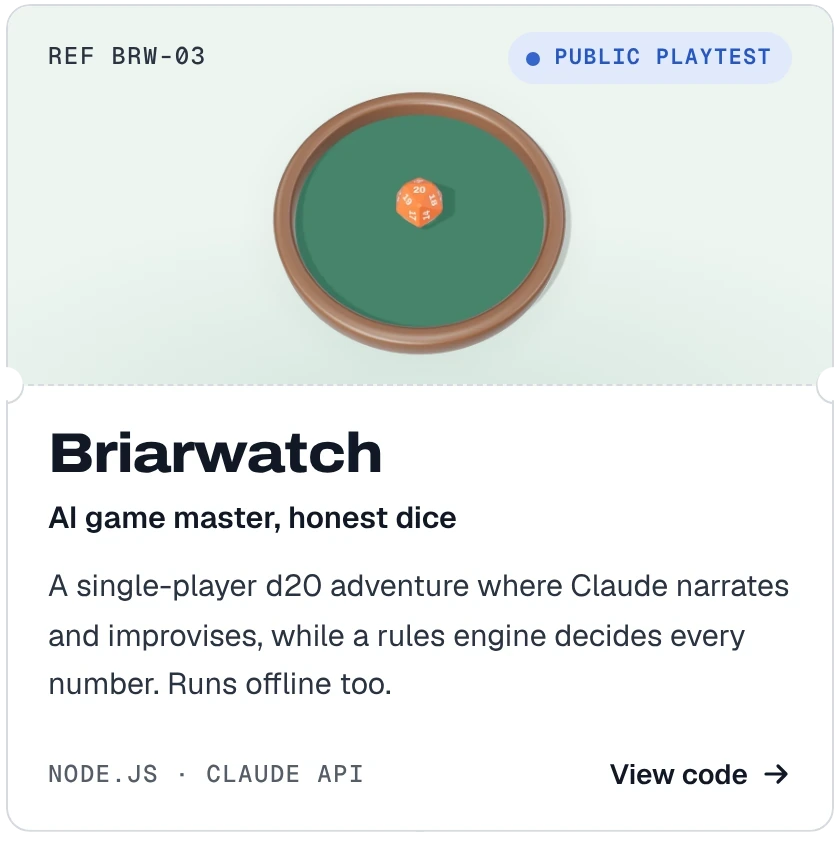
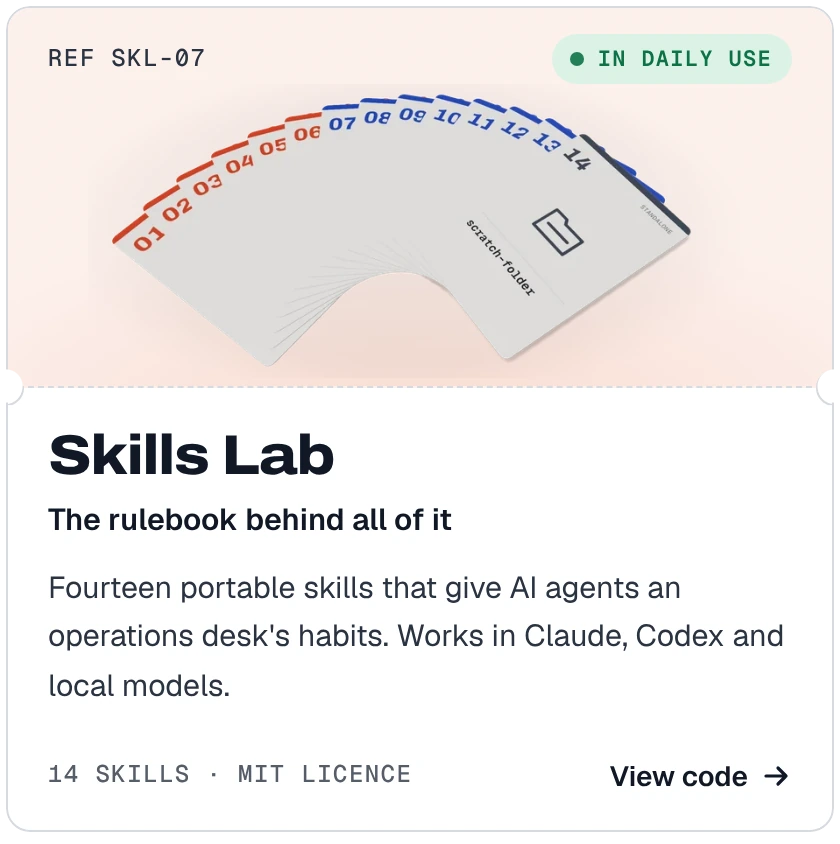
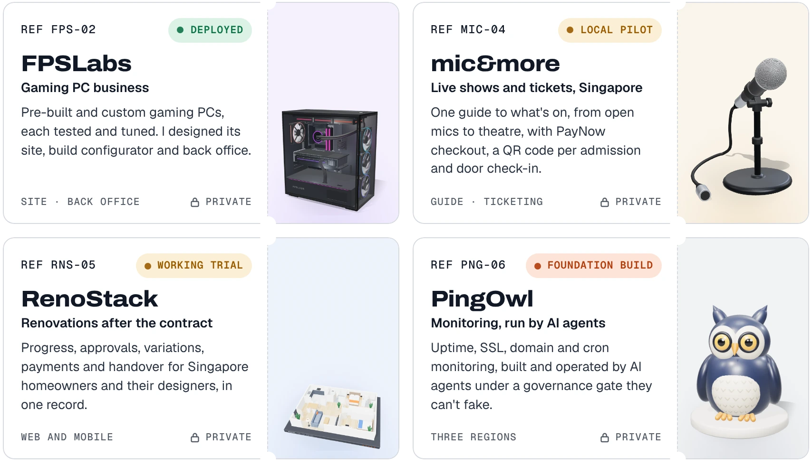
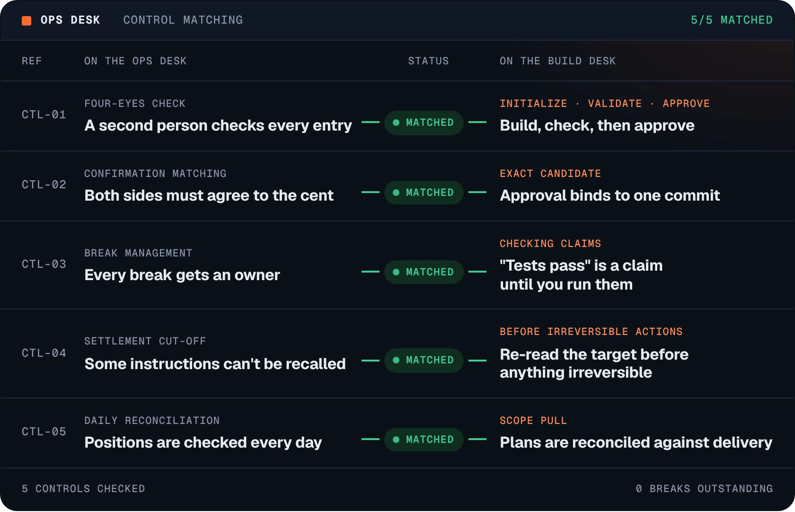

<picture>
  <source media="(prefers-color-scheme: dark)" srcset="https://raw.githubusercontent.com/curtistankiatming/curtistankiatming/main/assets/banner-dark.webp">
  
</picture>

I'm Curtis, an operations analyst in Singapore. Outside work I design products and direct AI agents to build them. I write the brief, make the product calls and approve every change; the agents (Claude, mostly; Codex sometimes) write the code.

More about me, including my day job, is on [curtistkm.com](https://curtistkm.com).

### Public code

  <a href="https://github.com/curtistankiatming/AI-DnD-GM"><picture><source media="(prefers-color-scheme: dark)" srcset="https://raw.githubusercontent.com/curtistankiatming/curtistankiatming/main/assets/briarwatch-dark.webp"></picture></a>
  <a href="https://github.com/curtistankiatming/skills-lab"><picture><source media="(prefers-color-scheme: dark)" srcset="https://raw.githubusercontent.com/curtistankiatming/curtistankiatming/main/assets/skills-lab-dark.webp"></picture></a>

### In the workshop

Four more products, built the same way. Their code is private for now.

<picture>
  <source media="(prefers-color-scheme: dark)" srcset="https://raw.githubusercontent.com/curtistankiatming/curtistankiatming/main/assets/workshop-dark.webp">
  
</picture>

### Two desks, one discipline

Trade operations taught me that nothing counts until it matches. I build software the same way: every change has to match its approval before it ships.

<picture>
  <source media="(prefers-color-scheme: dark)" srcset="https://raw.githubusercontent.com/curtistankiatming/curtistankiatming/main/assets/controls-dark.webp">
  
</picture>

### Say hello

The best way to reach me is a message on [LinkedIn](https://www.linkedin.com/in/curtistkm). I'm happy to compare notes on trade operations, controls for AI agents, or any of the projects here.
